# Báo cáo kỹ thuật — VieEdge-Voice

> Trợ lý giọng nói tiếng Việt chạy hoàn toàn offline trên Raspberry Pi 5 (8 GB, Yocto PREEMPT_RT) và trên điện thoại Samsung Galaxy Z Fold7 (NPU Hexagon); Hailo-8L chỉ dùng làm kết quả so sánh (chưa đạt).
> Số liệu lấy từ `results/experiments.csv` (mỗi dòng có commit và ghi chú), bảng đầy đủ ở `docs/report/tables.md`,
> hình ở `docs/report/figures/`. Số đo laptop ghi `os_cfg=laptop` và **không** phải số trên Pi. Mọi chỗ chưa đo được đều ghi rõ.

## 1. Giới thiệu
Bài toán: nghe, hiểu và trả lời bằng tiếng Việt trên một bo mạch nhúng, không Internet, độ trễ đủ cho hội thoại.
Ràng buộc: Hailo-8L chỉ chạy được mạng tĩnh (encoder Whisper), không chạy LLM; CPU Pi 5 có 4 nhân Cortex-A76 (dotprod, không i8mm).
Ba đóng góp: (1) pipeline streaming đo được từng chặng; (2) so sánh Pi OS và Yocto-RT trên cùng phần cứng và cùng bài đo;
(3) các tối ưu độ chính xác/độ trễ kèm số đo, kể cả những cái **không** có lợi (mục 4, 8).

## 2. Kiến trúc
Mic → tiến trình âm thanh RT (lõi 3, SCHED_FIFO, ring bộ nhớ chia sẻ) → Silero VAD → STT tăng dần (speculative final) → [đường nhanh | RAG → LLM llama.cpp] →
tách câu (câu đầu sau 5 từ) → chuẩn hoá tiếng Việt → Piper TTS → loa. Lõi 0–2 cho STT/LLM/TTS. Telemetry ghi từng lượt:
`speech_end → stt_final → llm_first_token → first_chunk → first_audio`; dashboard FastAPI + WebSocket.

## 3. Nhận dạng giọng nói
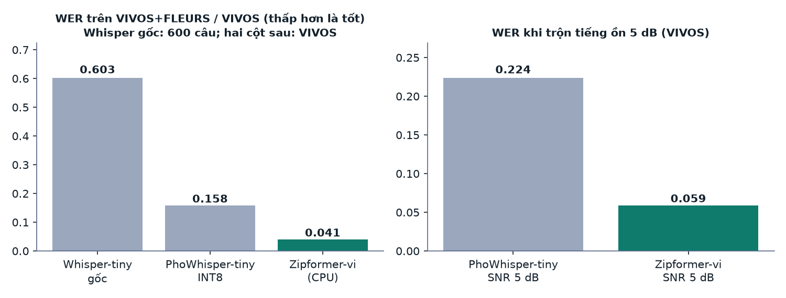
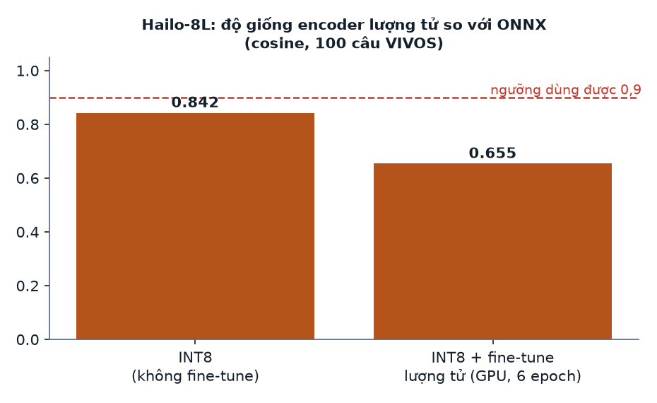

| Backend | WER VIVOS | WER 5 dB | thời gian/câu |
|---|---|---|---|
| PhoWhisper-tiny INT8 (CTranslate2) | 0,158 | 0,224 | ≈ 100 ms |
| **Zipformer-30M RNN-T (sherpa-onnx, int8, CPU)** | **0,041** | **0,059** | 29 ms |

Mặc định là Zipformer (giấy phép CC BY-NC-ND: chỉ nghiên cứu/thi). Độ tin cậy = log-prob trung bình token; dưới ngưỡng thì nói
"bạn nói lại giúp mình" (AUROC 0,84–0,87).

**Encoder PhoWhisper trên Hailo-8L: chưa dùng được.** HEF biên dịch xong (19–20 MB) nhưng cosine lượng tử so với ONNX chỉ 0,842
(INT8) và 0,655 (thêm fine-tune lượng tử 6 epoch trên GPU) — dưới ngưỡng 0,9 (`results/hailo_compile/`). Nguyên nhân khả dĩ:
các lớp a16 của hailo-whisper bị bỏ vì DFC 3.34 không hỗ trợ `precision_change`. Chưa có WER trên Hailo thật.

## 4. LLM trên CPU
LoRA trên Qwen3.5-0.8B (dữ liệu tự sinh 3.464 cặp hỏi–đáp, lọc và kiểm tra sự thật).
* Chọn 0,8B thay 1,5B: âm đầu tiên 1,70 s so với 2,52 s (laptop 3 lõi), điểm giám khảo 3,63 so với 3,81.
* **Định dạng lượng tử trên Cortex-A76 (Pi 5, Pi OS)**: Q4_0 được llama.cpp repack sang kernel dotprod 4×4 →
  nạp prompt 125 token/s (Q4_K_M: 88), sinh 18,2 (16,2). MCQ Global-MMLU-vi n=400: Q4_K_M 0,333, Q4_0 0,308, IQ4_NL 0,340, Q8_0 0,393
  (sai số ±2,4 điểm: ba định dạng 4-bit chưa phân biệt được). Đầu cuối, độ trễ âm đầu tiên **không cải thiện trong sai số đo**.
* **Không có lợi, đã bỏ:** giải mã suy đoán (13,9 so với 14,3 token/s); cửa sổ STT thích ứng (WER tăng gấp đôi); LoRA nhiễu ASR (+0,14 trên câu qua STT, −0,16 trên câu sạch).
* Engine khác (T-MAC, KleidiAI, ik_llama.cpp) không áp dụng được cho model 4-bit trên Cortex-A76 (`docs/OPTIMIZATION_NOTES.md`).

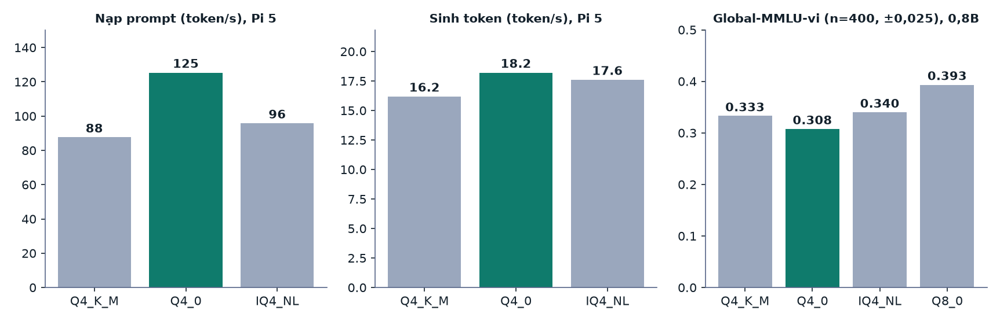

## 5. RAG offline
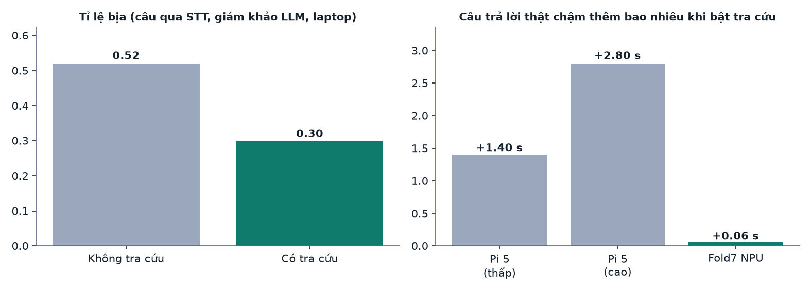

Wikipedia tiếng Việt (200.000 bài, 1,7 triệu đoạn) → SQLite FTS5 (BM25, không dấu), chèn 240 ký tự vào lượt người dùng.
Tỉ lệ bịa 0,52 → 0,30 (câu qua STT), 0,30 → 0,18 (câu gõ); truy hồi 9 ms nhưng **thêm ≈0,65 s** âm đầu tiên (nạp prompt dài hơn) — bật/tắt ngay trên dashboard.

## 6. TTS
Piper vi_VN. Thử giọng cho câu trả lời trên Pi Yocto-RT (12 lượt): vais1000-medium 2,30 s, 25hours_single-low 2,23 s, vivos-x_low 1,78 s đến khi câu trả lời thật bắt đầu.
Giọng x_low nhanh hơn ≈0,5 s nhưng chất giọng thấp hơn; chưa đổi mặc định (cần nghe thử).

## 7. Độ trễ đầu cuối và "không thời gian chết"
Trên Pi Yocto-RT, tắt RAG, Q4_0, Zipformer (tính từ lúc nói xong; 12–16 lượt, giọng đọc tổng hợp):
| Chặng | p50 |
|---|---|
| chờ ngắt câu (endpoint) | 0,42 s |
| STT ra chữ | 0,15 s |
| LLM ra token đầu | 0,31 s |
| câu đầu (5 từ) sẵn sàng | 0,75 s |
| **câu trả lời thật bắt đầu phát** | **≈2,0 s** (p95 ≈3,3 s) |

Ba biện pháp giảm độ trễ *cảm nhận*:
1. **Xác nhận tức thì** ("Dạ.") phát trong lúc LLM nghĩ: tiếng đầu tiên 2,45 → 0,53 s (p50), nhưng câu trả lời thật không đến sớm hơn.
2. **Đường nhanh** (`src/vieedge/fastpath`): luật phản xạ Go2 + 149 cặp hỏi–đáp có sẵn, trả âm thanh đã tổng hợp, không qua LLM: **0,52 s** (≈ thời gian chờ ngắt câu)
   so với 2,1–3,6 s qua LLM. Độ phủ 255/300 lệnh Go2 (85 %); 0/345 câu hỏi kiến thức bị cướp nhầm. Câu "nói lại giúp mình" cũng lấy từ cache (1,15 → 0,53 s).
3. endpoint 300 ms + câu đầu 3 từ: câu trả lời thật sớm hơn ≈0,4 s ở p50, p95 không đổi; chưa thử với giọng người (nguy cơ cắt ngang).

**Điện thoại làm micro + loa (Pi như máy chủ, ứng dụng Android hoặc trang `/phone`):** câu trả lời thật khi tắt tra cứu 1,6–1,8 s (nghe tiếng "Dạ." lúc 0,59 s), khi bật tra cứu 3,0–4,5 s; lệnh có sẵn nghe lúc ≈ 0,59 s (`results/phone/pi_phone_path_20261021.md`). Công tắc "Tra cứu" nằm ở đầu trang.
Chưa đo: bằng loa/mic USB thật, bằng giọng người thật.

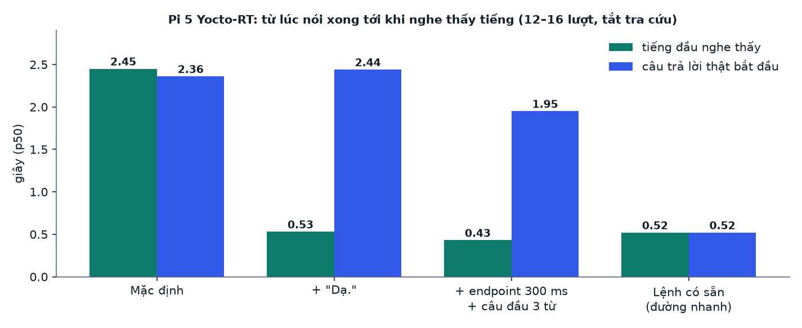

## 8. Hệ điều hành: Pi OS và Yocto-RT (cùng board, cùng bài đo `bench/compare_os.sh`)
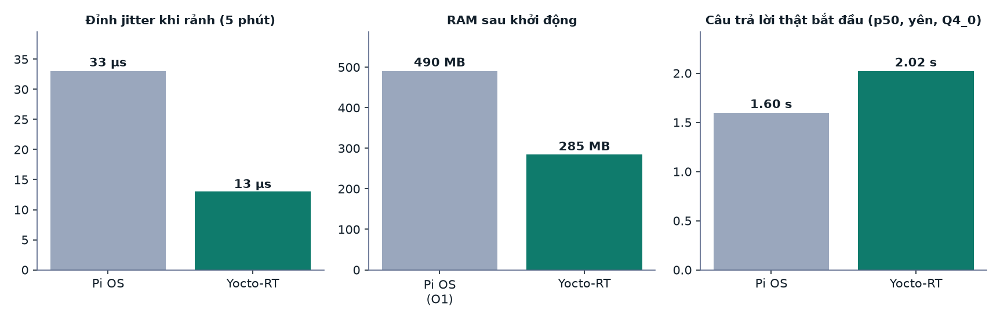

| Chỉ số (cùng board, cùng bài đo, cùng Q4_0) | Pi OS nguyên bản (O0) | Yocto-RT (O4) |
|---|---|---|
| Jitter lõi 3, rảnh, 5 phút (max) | 33 µs | 13 µs |
| Jitter lõi 3, tải nặng, 5 phút (max / p99.999) | 105 / 97 µs | **85 / 80 µs** |
| Jitter lõi 3, tải nặng, 30 phút, 1,8 triệu mẫu (max) | 127 µs | 92 µs |
| Câu trả lời thật bắt đầu, yên (p50 / p95) | **1,60 / 3,62 s** | 2,02 / 3,78 s |
| Câu trả lời thật bắt đầu, nhiễu 4 lõi (p50 / p95) | 9,3 / 20,7 s | 6,5 / 17,8 s |
| Lệnh Go2 qua đường nhanh (p50) | 0,53 s | 0,52 s |
| RAM sau boot | ≈ 440–540 MB (O1) | 285 MB |
| Ảnh hệ điều hành (nén) | – | 229 MB |

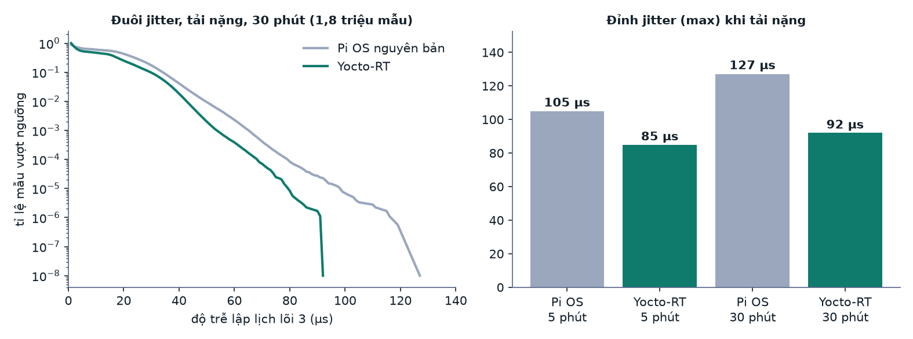

Kết luận trung thực: Yocto-RT giảm **đỉnh** jitter của lõi âm thanh 19–28 % và dùng ít RAM hơn; p99–p99.99 gần như bằng nhau. **Độ trễ trả lời khi yên, Pi OS nhanh hơn ≈ 0,4 s** trong lần đo này (n=16; chưa rõ nguyên nhân, cần `llama-bench` trên Yocto).
Ưu thế thực tế của Yocto: cô lập lõi âm thanh (`isolcpus=3 nohz_full rcu_nocbs`), ảnh nhỏ, dựng lại được từ cấu hình — không phải tốc độ suy luận.
Chưa đo: thời gian boot Yocto, xrun với loa thật, `llama-bench` trên Yocto.

## 9. Ứng dụng Android chạy tại chỗ trên Galaxy Z Fold7 (Snapdragon 8 Elite)
Ứng dụng Kotlin + Compose chạy cả đường ống trên điện thoại: Silero VAD → Zipformer-vi (sherpa-onnx) → đường nhanh / RAG (SQLite FTS5 qua requery) → llama.cpp trong tiến trình (JNI) → tách câu → Piper → loa. Không cần mạng, không cần Pi.
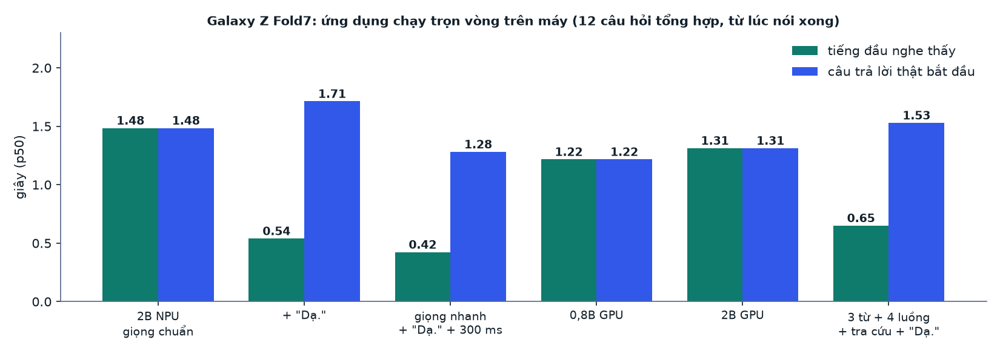

| Chỉ số (12 câu hỏi tổng hợp, từ lúc nói xong) | Kết quả |
|---|---|
| Mô hình 2B, NPU Hexagon, tra cứu bật, "Dạ." bật | tiếng đầu 0,65 s; câu trả lời thật 1,53 s |
| Tốc độ nạp prompt (so với Pi 5) | gấp ≈ 16 lần |
| Tra cứu Wikipedia trên điện thoại | 96 ms p50; prompt 25 → 107 token; thêm ≈ 0,06 s |
| WER 12 câu tổng hợp | 0,257 (laptop 0,250) |
| Chạy liên tục 7,5 phút, 62 lượt | NPU tối đa 65 °C; 25,3 token/s đầu và cuối — không hạ xung |
| Công suất cả máy (kể cả màn hình), rút sạc | 2,2–3,3 W; ≈ 16 J mỗi lượt (Pi 5: 3,2–3,3 W chỉ bo mạch) |

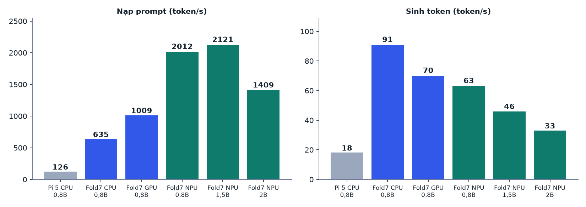
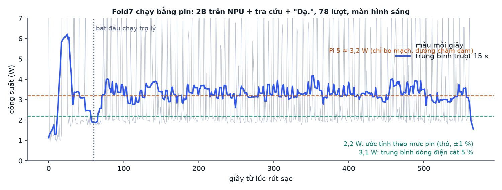
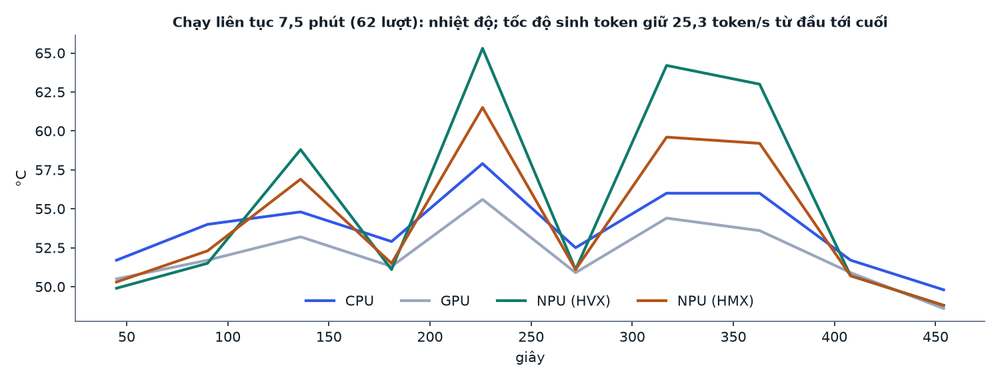

Chống nhiễu: cổng RMS so với mức ồn nền thích ứng (≥ 2,5×), tắt AGC, bỏ câu một từ trừ khi trúng đường nhanh — sau khi AGC làm khuếch đại tiếng ồn và sinh chữ ảo.
Giới hạn: câu hỏi là giọng tổng hợp, chưa đo bằng giọng người thật (người dùng tự kiểm); công suất chưa tách riêng NPU; dòng điện nhiễu nên ghi dạng khoảng.
Số liệu: `results/phone/` (`fold7_campaign_20261027.md`, `fold7_tuning_20261027.md`, `fold7_llama_bench_20261021.md`).

## 10. Hạn chế
* Câu hỏi test là giọng đọc tổng hợp (khó hơn giọng người với Zipformer: WER 0,19 so với 0,04 trên VIVOS); giám khảo là LLM.
* Mỗi cấu hình 12–16 lượt: đủ để thấy chênh lệch lớn, không đủ cho chênh lệch dưới 10 %.
* Zipformer phi thương mại; VIVOS có thể trùng một phần dữ liệu huấn luyện của nó.
* Đường Hailo chưa hoạt động; mọi đo STT trên Pi là CPU.
* Yocto: không dựng lại ảnh sau các thay đổi cuối (đường nhanh, chứng chỉ đã nằm trong recipe nhưng chưa nạp lại lên thẻ).

## 11. Kết luận
Hệ thống chạy offline trọn vòng trên Pi 5 và trên điện thoại (câu trả lời thật ≈1,5 s với NPU): hỏi → nhận giọng 0,15 s → trả lời bắt đầu ≈2 s (câu có dữ liệu sẵn ≈0,5 s). Đóng góp có giá trị khoa học là
số đo trung thực trên cùng phần cứng (Yocto-RT giảm đỉnh jitter, không làm LLM nhanh hơn) và danh sách các tối ưu *không* hiệu quả.

## Phụ lục: tái lập
`docs/RUNBOOK.md`, `bench/compare_os.sh <tag> <phút>`, `scripts/rt_compare.sh`, `bench/jitter_long.sh`; commit ghi trong `experiments.csv`.

## Phụ lục: các hình bổ sung
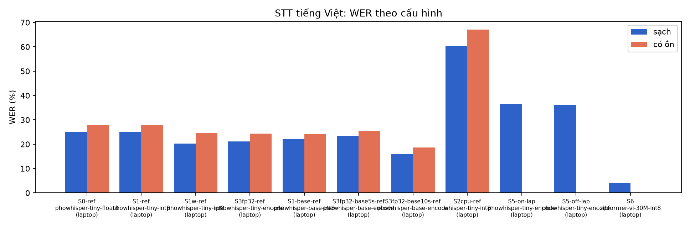
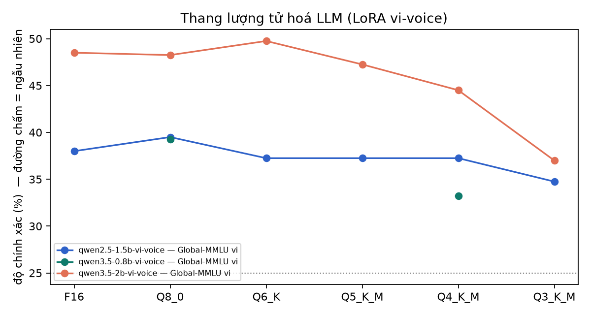
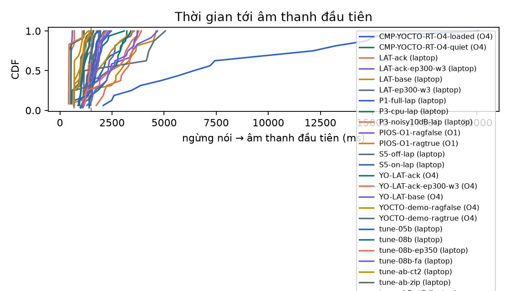
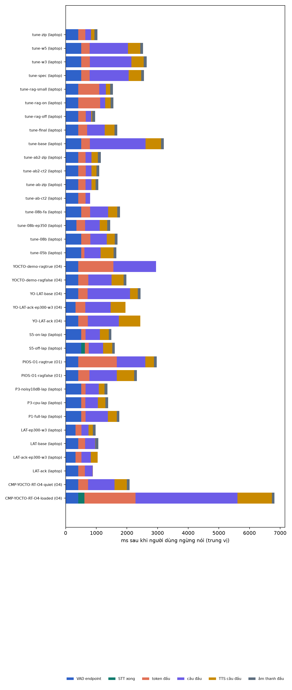
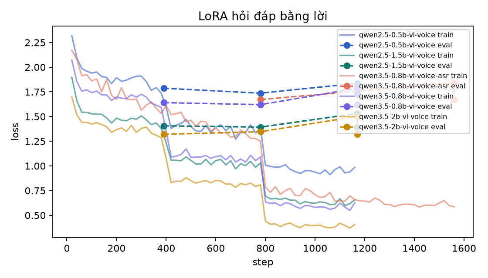
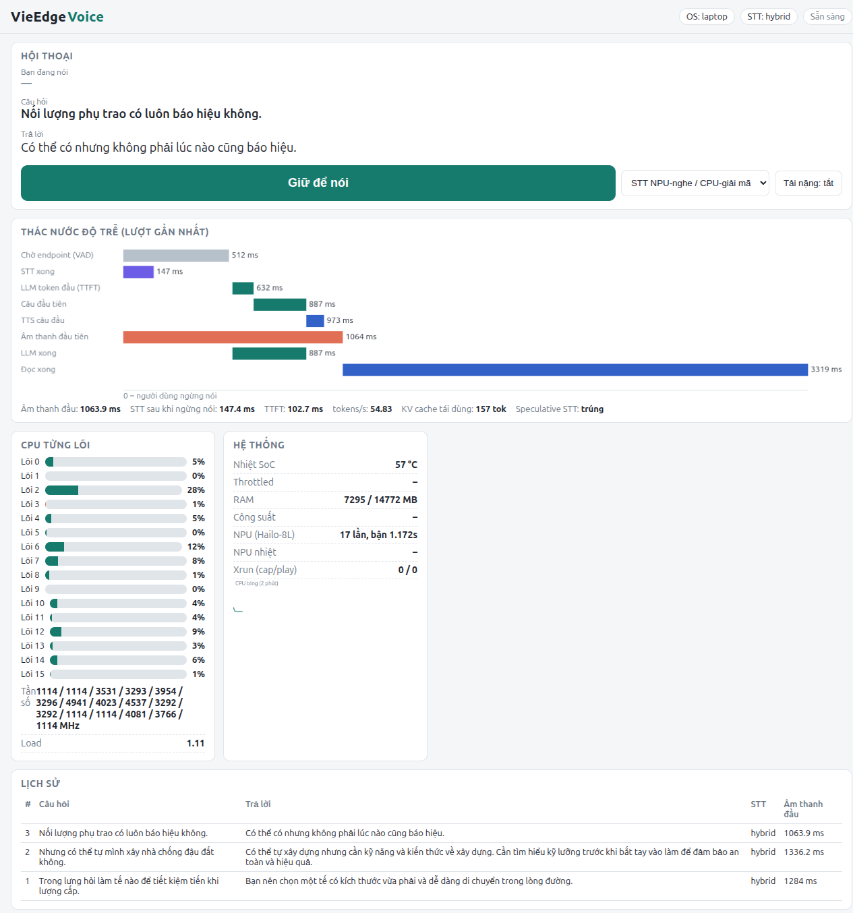
